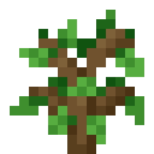
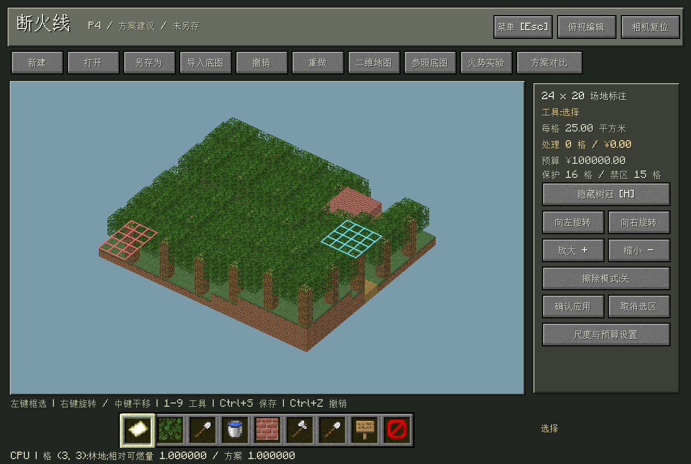
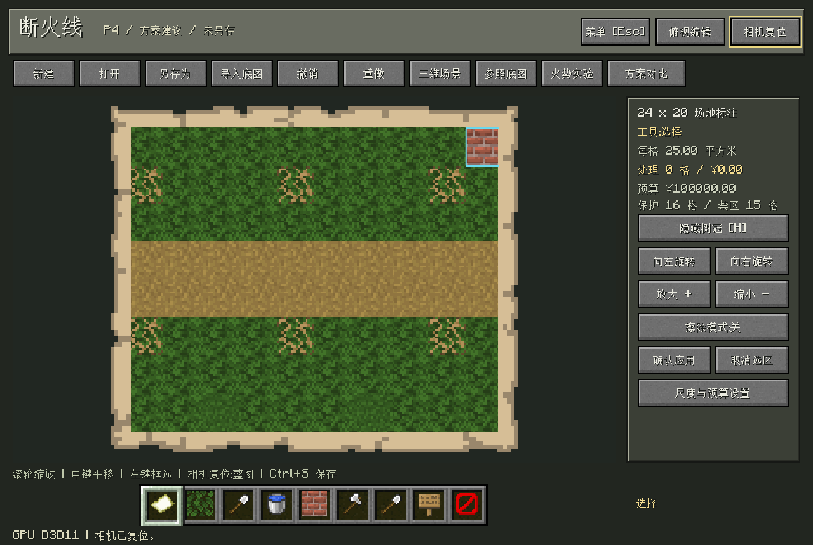
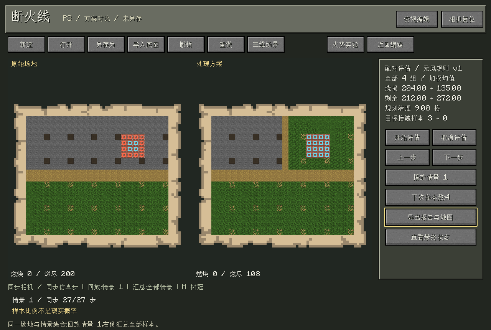

# Firebreak · 断火线

<p align="center">
  
</p>

<p align="center">
  A forest fire planning sandbox built with Cangjie, SDL3 and GPU voxel rendering.<br>
  Map a site, design firebreaks, and compare fire spread and costs under matched ignition scenarios.
</p>

<p align="right"><a href="README.md">简体中文</a> · English</p>

<p align="center">
  
  
  
  
</p>

<p align="center">
  <a href="#features">Features</a> · <a href="#screenshots">Screenshots</a> · <a href="#run">Run</a> · <a href="#technology-and-docs">Technology &amp; docs</a>
</p>

## Features

- **Site editing:** 3D sandbox and textured overhead map, reference images, land annotations, protected targets, exclusion zones, and undo/redo.
- **Fire experiments:** inspect forest connectivity, configure ignition and spread, step through simulations or replay snapshots.
- **Paired comparisons:** evaluate baseline and treatment plans using matched scenarios and seeds; inspect simulated losses, target contact and treatment costs.
- **Budget planning:** preview a finite set of candidate treatments, apply them manually, and export reports and maps.
- **Minecraft-inspired interaction:** pixel textures, parchment maps, a book-style handbook, Chinese/English UI and optional smooth lighting.

## Screenshots

### 3D site

Edit the forest, roads and protected areas in one navigable scene. Grass uses the meadow tint `#83BB6D`.



### Overhead map

Block textures remain visible while zooming and panning for local inspection and annotation.



### Plan comparison

Both views share navigation and replay time. Replay shows one scenario; summary metrics cover the entire evaluated sample set.



## Run

Requires Windows x64, Cangjie SDK **1.0.5**, and a Minecraft resource directory containing `textures/` and `font/`.

```powershell
$env:CANGJIE_HOME = 'C:\path\to\cangjie'
$env:MINECRAFT_ASSETS = 'D:\path\to\minecraft-assets'
.\build.ps1 -Run
```

The build script prepares pinned stdx/SDL dependencies and verifies/caches the grass texture source. Original Minecraft assets are excluded from this repository. The first build requires internet access. After building, launch with `run.cmd`.

Open the [connector camp example](examples/connector-camp.firebreak), edit a treatment strip, then choose Fire Trial or Compare Plans. **Esc** opens the menu, **H** toggles canopies; right-drag rotates, middle-drag pans, and the wheel zooms.

## Technology and docs

Cangjie implements application logic, simulation and graphics host code. SDL3 handles the window and UI. D3D11/HLSL performs chunk skipping, voxel ray traversal and surface shading on the GPU. Run `./build.ps1 -Verify` for native logic and GPU checks.

The application uses percolation connectivity and discrete spread for relative plan comparisons. The planning grid is **24×20**, with a simplified four-neighbor, wind-free model. Results support teaching and model-based comparisons, not real wildfire prediction. The large-forest example is a separate rendering diagnostic.

Technical documents are primarily in Chinese: [Model](docs/P2_MODEL.md) · [Evaluation](docs/P3_EVALUATION.md) · [Budget planning](docs/P4_PLANNING.md) · [GPU renderer](docs/GPU_RENDERING.md) · [Smooth lighting](docs/SMOOTH_LIGHTING.md) · [Third-party resources](THIRD_PARTY.md)
