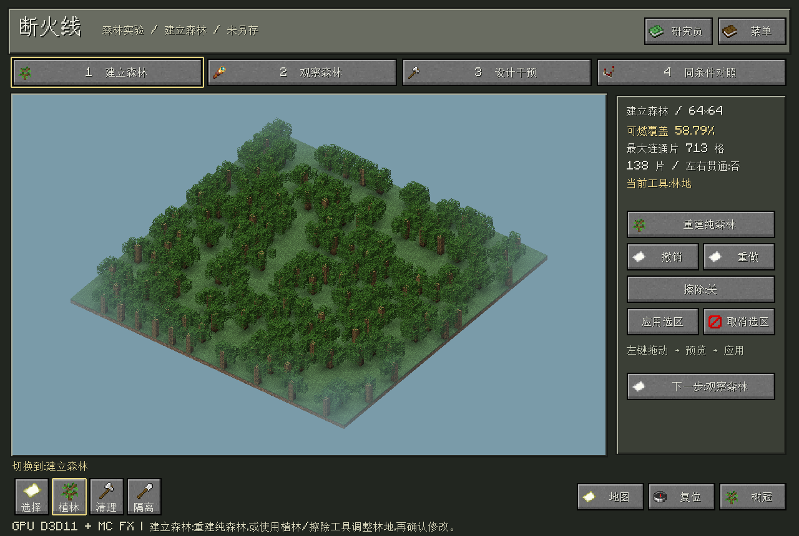
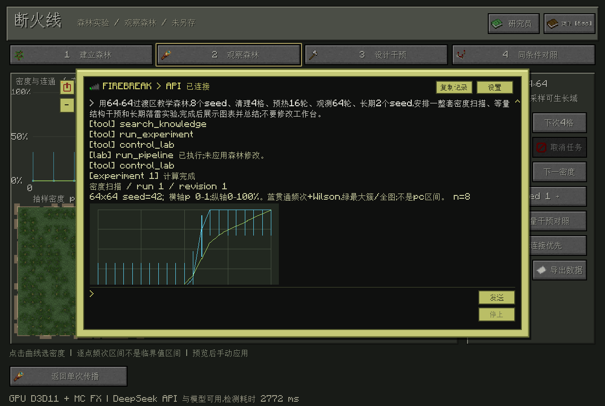
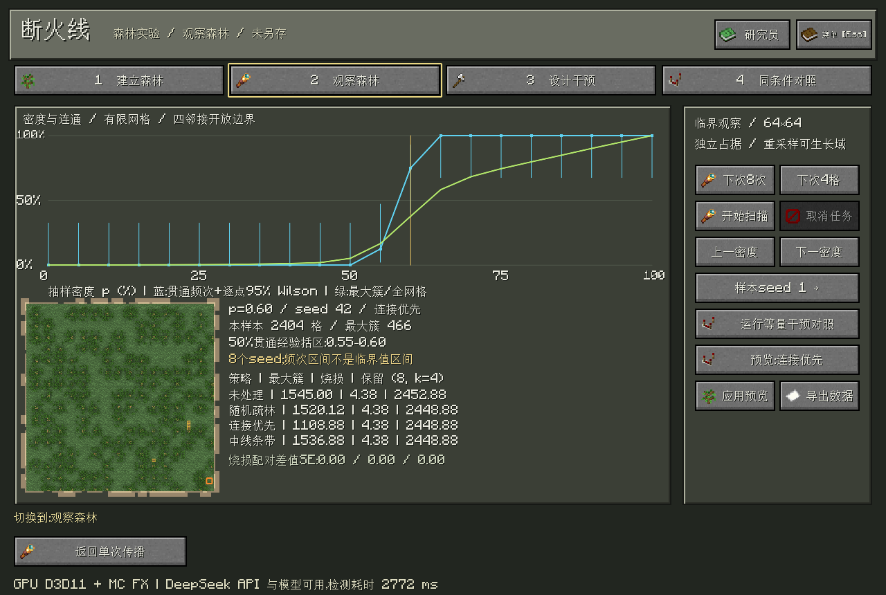
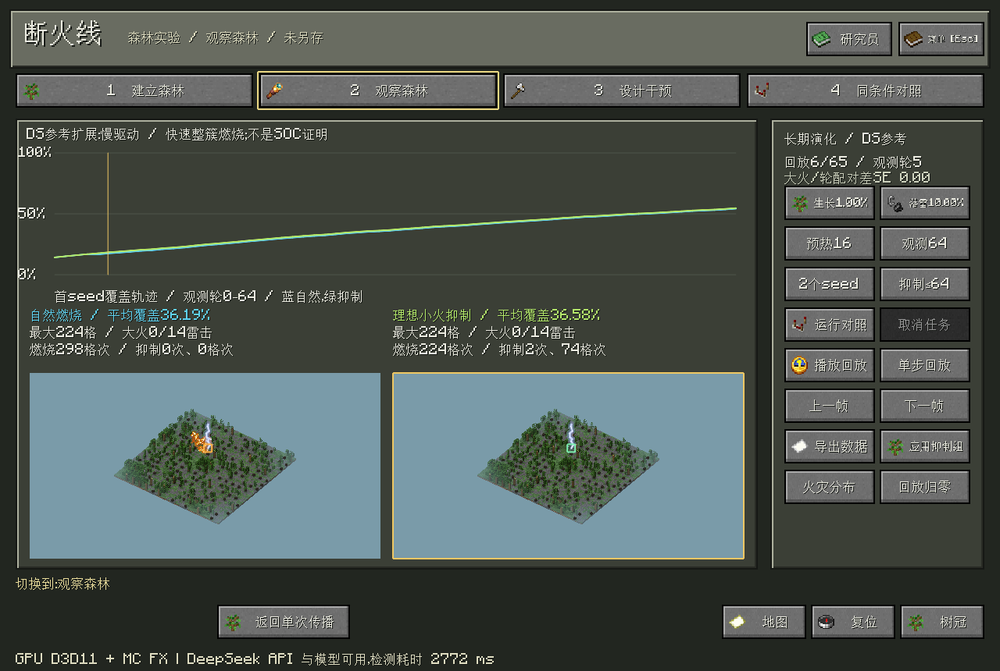

# Firebreak · 断火线

<p align="center">
  
</p>

<p align="center">
  基于仓颉、SDL3 与 GPU 体素渲染的森林实验沙盘。<br>
  观察森林如何连成一片，比较干预能否阻断大范围传播。
</p>

<p align="center">
  
  
  
  
  <a href="LICENSE"></a>
</p>

<p align="center">
  <a href="#功能">功能</a> · <a href="#一句话跑完整实验">一句话实验</a> · <a href="#运行">运行</a> · <a href="#模型与边界">模型与边界</a>
</p>

## 功能

- **森林编辑与观察**：24×20、64×64、128×128平坦网格；三维场景和二维纹理地图，支持植林、清理、隔离带及撤销重做。
- **临界区探索**：多密度、多seed扫描，观察贯通频次、最大连通片和不确定性；比较相同清理量的不同干预策略。
- **传播与长期演化**：单次火势回放、同条件配对比较，以及DS参考的生长、随机落雷、整簇燃烧与理想小火抑制。
- **AI研究员**：DeepSeek流式对话、受控工具调用、本地操作/数学知识检索；一句话启动实验，查看真实结果图卡与解释。
- **MC风格界面**：像素材质、羊皮纸地图、书本手册、中英文与自适应UI，提供光照、FPS和声音设置。



## 一句话跑完整实验

1. 在 **Esc → 智能体设置** 填写DeepSeek模型和API Key，保存并测试连接。后续启动会自动后台检测。
2. 点击 **研究员**，或按 `/` 打开快捷输入。可使用当前森林，也可在指令中指定教学森林。
3. 发送下面这句话，程序会连续完成三个实验阶段，返回图卡和总结，无需逐步追问。

> 用64×64过渡区教学森林，8个seed、清理4格、预热16轮、观测64轮、长期2个seed，安排一整套密度扫描、等量结构干预和长期落雷实验，完成后展示图表并总结；不要修改工作台。

**密度扫描 → 等量结构干预 → 长期生长／落雷对照 → 图卡与解释**

| 阶段 | 程序做什么 | 查看什么 |
|---|---|---|
| ① 密度扫描 | 扫描21个密度，每个密度重复8个seed；选择已测贯通频次最接近50%的点 | 贯通频次、Wilson区间、最大连通片与样本地图 |
| ② 等量干预 | 在选定密度下，比较未处理、随机清理、连接优先和中线条带 | 相同清理量下的烧损、剩余林地与结构变化 |
| ③ 长期对照 | 从选定密度的未处理样本开始，比较自然燃烧和理想小火抑制 | 覆盖率轨迹、火灾规模、抑制次数与代价 |

以下四张截图来自同一次真实DeepSeek工具调用；示例参数仅用于快速体验。



**① 密度扫描：观察有限网格中的贯通过渡区。**


**② 等量结构干预：查看连接优先策略的样本，修改仍需手动应用。**



**③ 长期对照：自然燃烧与理想小火抑制的轨迹、统计和回放。**



图卡可点击放大，滚轮翻阅对话，`/stop`取消任务，`/preview`查看样本。实验使用副本，**不会自动修改工作台**；需在预览后手动应用。长期阶段独立比较两种燃烧规则，不是自动对“最佳清理方案”做长期验证。

无需API时，输入 `/experiment` 对当前森林运行默认实验；`/help 落雷怎么操作`、`/help Wilson` 可离线检索指南和数学说明。

## 运行

需要 **Windows x64、仓颉SDK 1.0.5**。SDK已在终端环境中时，在项目根目录直接运行：

```powershell
cjpm run
```

尚未配置SDK环境时，先执行：

```powershell
$env:CANGJIE_HOME = 'C:\path\to\cangjie'
. "$env:CANGJIE_HOME/envsetup.ps1"
cjpm run
```

构建钩子会自动准备固定版本的依赖，并从官方源提取所需材质、字体和音频到本地 `assets/minecraft/`，无需手动准备MC素材。首次构建需要联网，之后复用缓存；原版资源及客户端缓存不进入源码仓库，也不适用项目的MIT许可。已有资源目录可选用 `MINECRAFT_ASSETS` 覆盖，已有音频不会被替换。

构建后也可双击 `run.cmd`，原有 `build.ps1` 继续可用。API Key需在应用菜单中自行填写。

默认载入64×64森林。顶部按 **建立森林 → 观察森林 → 设计干预 → 同条件对照** 操作；教学案例位于 **Esc → 文件与项目 → 新建场景 → 教学森林/完整实验**。

| 操作 | 用途 |
|---|---|
| 左键拖动 | 编辑选区，预览后确认应用 |
| 右键拖动／中键拖动 | 旋转／平移三维视角 |
| 滚轮 | 缩放场景或二维地图 |
| `H`／右下角按钮 | 隐藏树冠／切换地图、复位 |
| `Esc` | 项目、显示、声音、智能体设置与退出 |
| `Ctrl+S`／`Ctrl+Z` | 保存／撤销 |

单次传播、密度/干预和长期实验均有对应导出入口，可保存复现参数及原始记录。**Esc → 声音设置** 可分别调节按键和音乐音量；本地音频可通过构建参数 `-ClickSound`、`-BackgroundMusic` 指定。

<details>
<summary>验证与性能诊断</summary>

```powershell
.\build.ps1 -Verify
cjpm run --run-args '--benchmark-load'
# 下项需要本机已保存的API配置，会调用真实模型：
cjpm run --run-args '--verify-pipeline-live'
```

离线负载测试覆盖128×128网格、光照、燃烧双栏、长期回放和本地合成终端流，输出逐帧、汇总和进程内存CSV到 `artifacts/`，不调用模型API。首次创建GPU视图可能短暂停顿；短时测量不代表所有设备、长期运行或十万树动态模拟的性能。

</details>

## 模型与边界

业务、仿真和图形主机使用仓颉，SDL3负责窗口与界面，D3D11/HLSL执行GPU体素射线遍历、区块跳过与表面着色，并保留CPU回退。

- 每格代表可燃空间单元；树木是稀疏体素示意。单次传播采用四邻接、无风概率模型，长期模式采用生长、全图落雷与快速整簇结算。
- 50%贯通附近的已测点不是精确临界值，Wilson区间是频次区间；有限实验不能证明SOC或真实火灾风险。
- 小火抑制是假定预知簇大小的理想规则，连接优先是启发式策略。输出用于教学与相对方案分析，不代表现实火灾预测。
- 研究员使用受限实验工具和本地关键词检索；云端图片输入、任意实验脚本和跨启动会话恢复不在当前能力内。

## 许可

项目原创代码采用 [MIT License](LICENSE)。第三方依赖保留其原许可证；Minecraft材质、字体、音频及截图中的相关素材不属于MIT授权范围，来源与使用说明见 [THIRD_PARTY.md](THIRD_PARTY.md)。

本项目不是Minecraft官方产品，未经Mojang或Microsoft认可，亦不与其存在关联。
