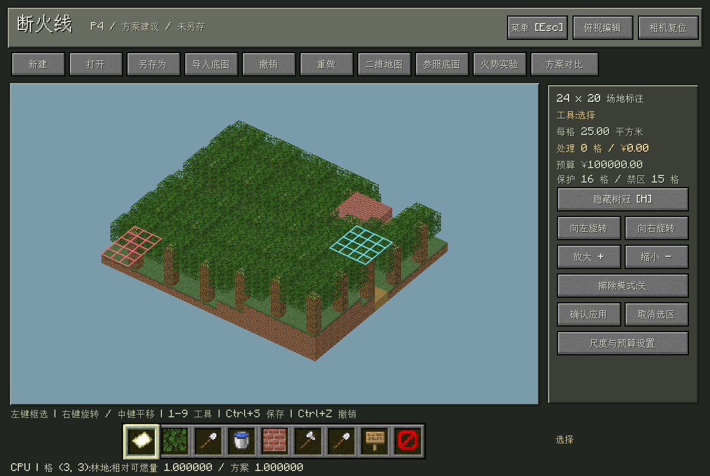
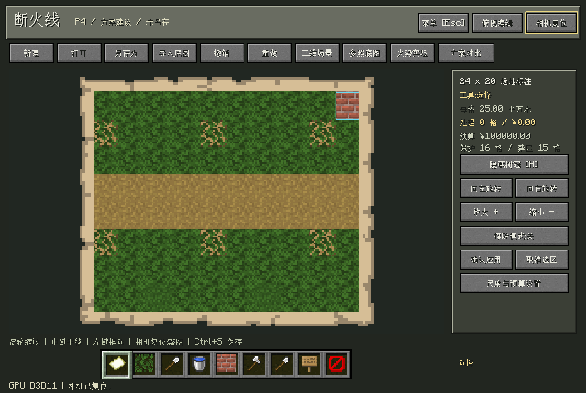
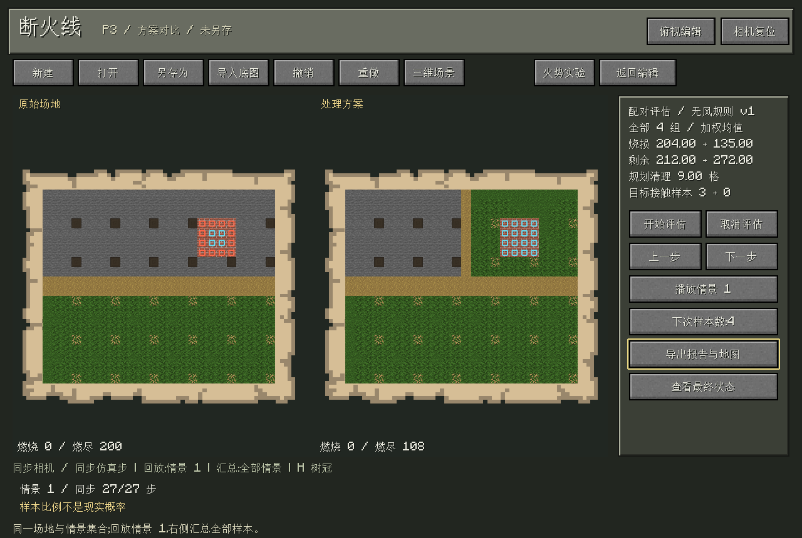

# Firebreak · 断火线

<p align="center">
  
</p>

<p align="center">
  基于仓颉、SDL3 与 GPU 体素渲染的森林防火规划沙盘。<br>
  标注林地、设计隔离带，在相同起火情景下比较处理前后的火势与成本。
</p>

<p align="center">
  
  
  
  
</p>

<p align="center">
  <a href="#功能">功能</a> · <a href="#界面预览">界面预览</a> · <a href="#运行">运行</a> · <a href="#技术说明">技术说明</a>
</p>

## 功能

- **场地编辑**：三维沙盘与二维纹理地图，支持底图导入、地类标注、保护目标、禁区及撤销重做。
- **火势实验**：查看森林连通性，设置起火点和传播参数，单步运行或回放燃烧过程。
- **方案比较**：在相同起火情景与随机种子下对照原始场地和处理方案，统计烧损、目标接触与处理费用。
- **预算规划**：生成有限候选处理带，预览、比较后手动应用，并导出报告与地图。
- **MC 风格交互**：像素材质、羊皮纸地图、书本手册，中英文界面及可选平滑光照。
- **电脑终端**：中文输入、会话记录、`/` 快捷输入与本地场地查询。

## 界面预览

### 三维场地

林地、道路和保护目标在同一沙盘中展示，可旋转、缩放与编辑。草地采用草甸色 `#83BB6D`。



### 二维地图

俯视图保留真实方块纹理，支持鼠标锚点缩放和平移，便于查看和标注局部区域。



### 方案对照

左右同步查看原始场地与处理方案；回放展示单个情景，统计汇总全部评估样本。



## 运行

需要 Windows x64、仓颉 SDK **1.0.5**，以及包含 `textures/`、`font/` 的 Minecraft 原版资源目录。

```powershell
$env:CANGJIE_HOME = 'C:\path\to\cangjie'
$env:MINECRAFT_ASSETS = 'D:\path\to\minecraft-assets'
.\build.ps1 -Run
```

构建脚本准备固定版本的 stdx/SDL 依赖，并校验、缓存草方块纹理来源。原版资源不包含在仓库中，首次构建需要联网。构建后可直接双击 `run.cmd`。

首次体验可打开 [双林地窄桥示例](examples/connector-camp.firebreak)，编辑处理带后使用“火势实验”或“方案对比”。**Esc** 打开菜单，**H** 切换树冠，右键旋转、中键平移、滚轮缩放。

点击“研究员”打开电脑终端，或按 `/` 使用快捷栏；`/site` 查看场地摘要，`/help` 查看操作说明。

DeepSeek 模型与 API Key 可在 **Esc → 智能体设置** 中填写，保存后可测试连接；密钥仅保存在本机，连接状态以检测结果为准。

## 技术说明

业务、仿真与图形主机代码使用仓颉，SDL3 提供窗口与界面；D3D11/HLSL 在 GPU 上执行区块跳过、体素射线遍历及表面着色。运行 `./build.ps1 -Verify` 可执行原生逻辑与 GPU 检查。

项目将渗流连通性与离散传播用于方案比较。正式规划网格为 **24×20**，采用四邻接、无风的简化模型；输出用于教学与相对方案分析，不代表现实火灾预测。大森林示例是独立的渲染诊断。

[第三方资源与来源说明](THIRD_PARTY.md)
