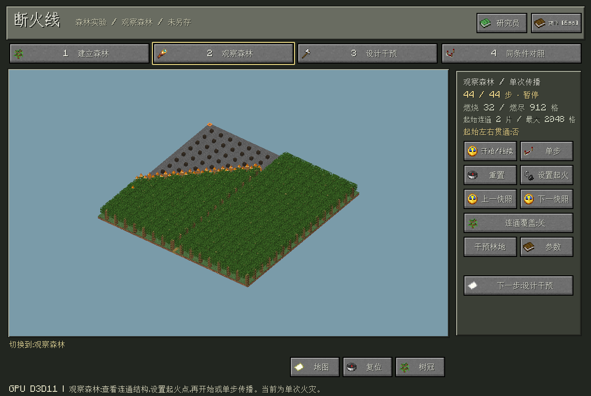
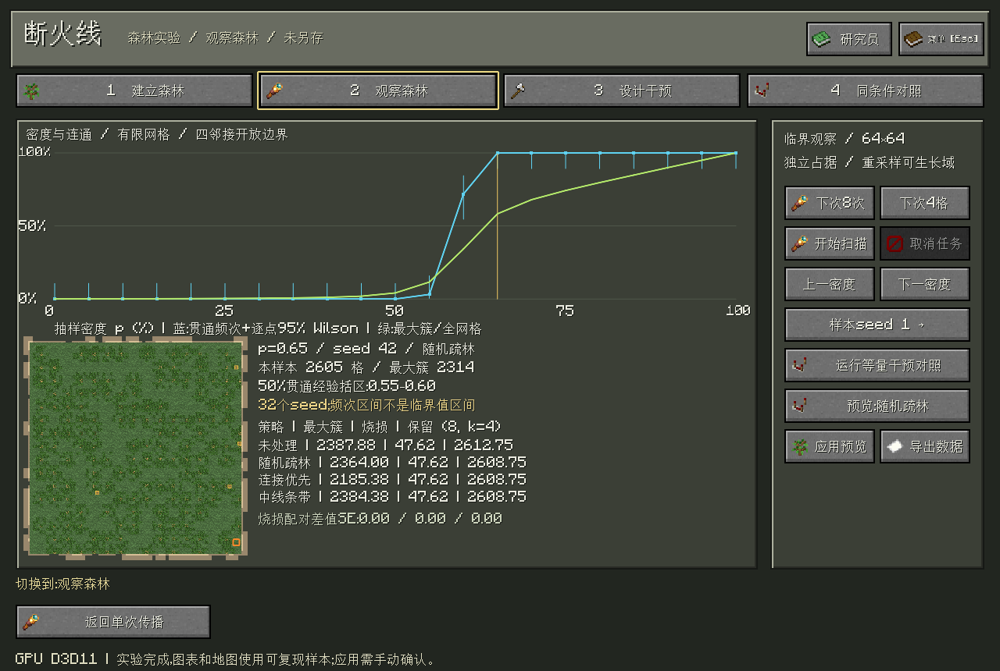
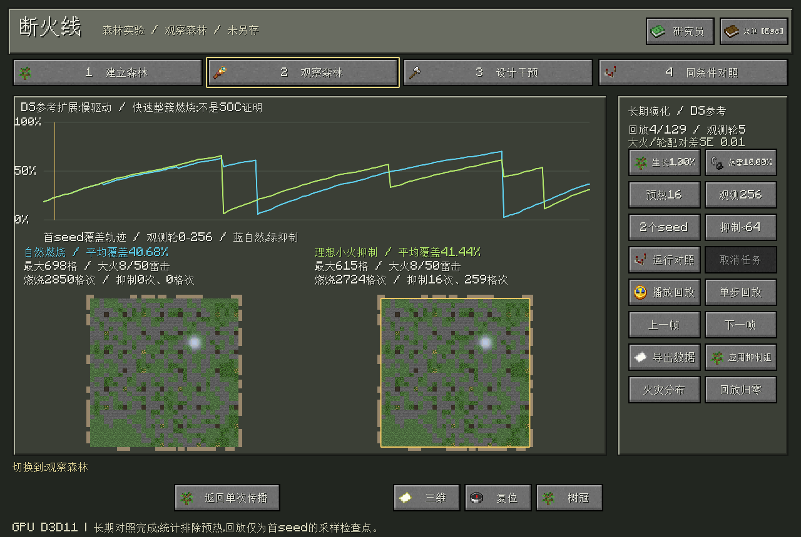
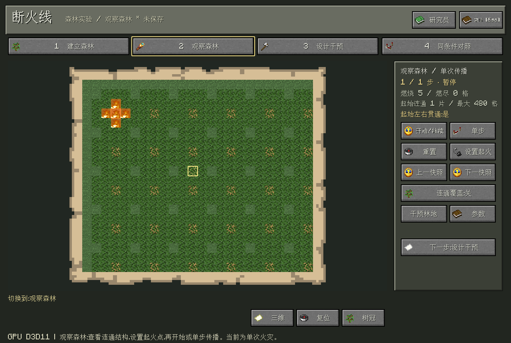
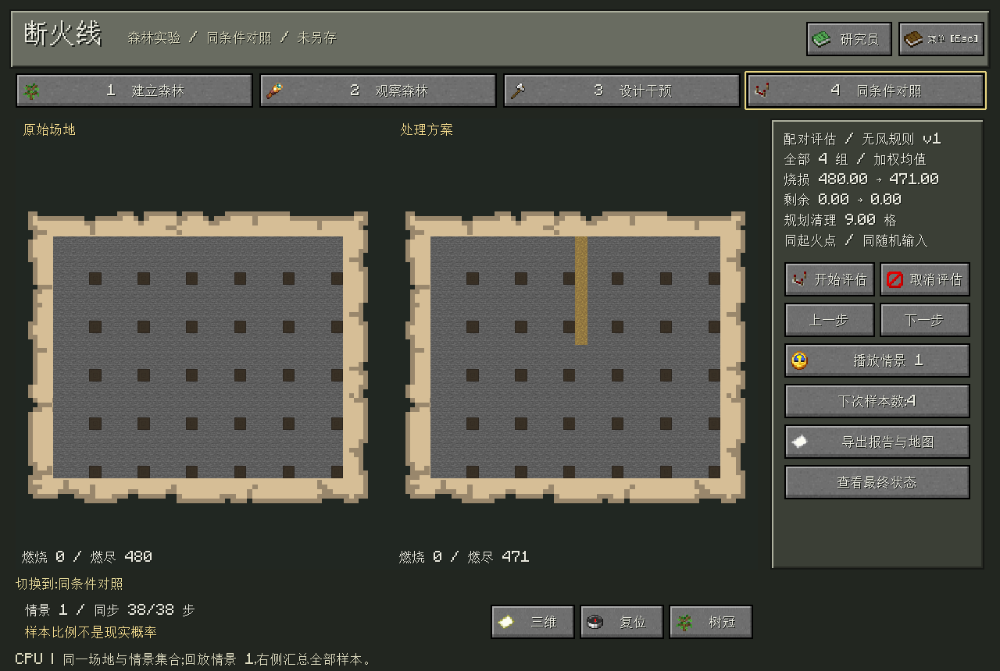
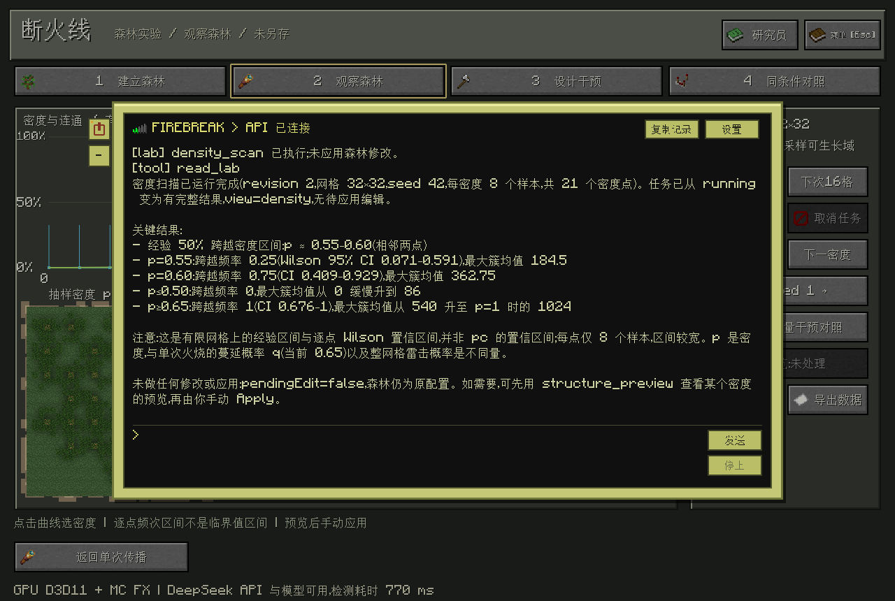

# Firebreak · 断火线

<p align="center">
  
</p>

<p align="center">
  基于仓颉、SDL3 与 GPU 体素渲染的森林实验沙盘。<br>
  建立森林 → 观察连通与传播 → 设计干预 → 在相同条件下对照结果。
</p>

<p align="center">
  
  
  
  
</p>

<p align="center">
  <a href="#功能">功能</a> · <a href="#界面预览">界面预览</a> · <a href="#运行">运行</a> · <a href="#技术说明">技术说明</a>
</p>

## 功能

- **四步工作流**：建立森林、观察森林、设计干预、同条件对照，配有 MC 图标与操作说明。
- **森林编辑**：24×20、64×64、128×128 平坦网格，三维沙盘与二维纹理地图；植林、清理和隔离带支持预览、应用及撤销重做。
- **传播与对照**：查看覆盖率、连通片与贯通状态；单步或回放火势，在相同起火情景与随机输入下比较烧损和保留林地。
- **临界观察**：重复 seed 扫描密度，显示最大连通片、贯通频次与不确定性；对照相同清理量的随机疏林、连接优先和中线条带，支持样本预览及数据导出。
- **长期演化**：DS参考的生长、随机落雷与整簇燃烧；配对比较自然燃烧与理想小火抑制，支持预热、多seed、火灾分布和完整逐轮数据导出。
- **高级工具**：文件导入、地类标注、保护目标、禁区及预算候选保留在菜单中，支持报告与地图导出。
- **MC 风格交互**：像素材质、羊皮纸地图、书本手册，中英文界面、平滑光照及独立音效/音乐音量。
- **本地知识检索**：操作指南与数学说明可通过 `/help 关键词` 离线查询；研究员结合检索段落与实时实验数据作答，附版本和出处。
- **AI 研究员**：DeepSeek 流式对话与CangjieMagic工具，读取真实实验状态，启动密度扫描、等量清理和长期对照；预览后手动应用。

## 界面预览

### 森林工作台

默认采用64×64、植被生成概率60%的森林，“重建纯森林”可选择尺寸、概率和seed。顶部选择实验步骤，左下选择编辑工具，右侧显示森林结构与下一步操作。草地采用草甸色 `#83BB6D`。



### 临界观察

进入 **观察森林 → 临界观察**，扫描可生长域上的独立植被样本。点击曲线查看对应纹理地图，再运行等量干预对照；预览须手动应用，可撤销。导出保留原始样本、汇总、SVG曲线与复现参数。



### 长期演化

进入 **观察森林 → 长期演化**，设置生长、落雷、预热和观测轮数后运行。左右回放首seed的采样检查点，统计覆盖全部seed；可导出数据或手动应用植被快照。



### 二维地图

俯视图保留真实方块纹理，支持鼠标锚点缩放和平移，便于查看和标注局部区域。



### 方案对照

左右同步查看原始场地与处理方案；回放展示单个情景，统计汇总全部评估样本。



## 运行

需要 Windows x64、仓颉 SDK **1.0.5**，以及包含 `textures/`、`font/` 的 Minecraft 原版资源目录。

```powershell
$env:CANGJIE_HOME = 'C:\path\to\cangjie'
$env:MINECRAFT_ASSETS = 'D:\path\to\minecraft-assets'
.\build.ps1 -Run
```

构建脚本准备固定版本的 stdx、SDL 与 CangjieMagic 依赖，并校验、缓存草方块纹理来源。原版资源不包含在仓库中，首次构建需要联网。构建后可直接双击 `run.cmd`。

默认启动纯森林。**H** 切换树冠，右键旋转、中键平移、滚轮缩放。**Esc → 旧版小案例** 保留以下合成用例；载入后作为新项目另存，不覆盖随附文件。

| 案例 | 场地与方案 | 体验重点 |
|---|---|---|
| 五格传播链 | [原始场地](examples/chain-baseline.firebreak) / [清理一格](examples/chain-firebreak.firebreak) | 左侧火源被阻断，右侧起火仍可能接触目标 |
| 百元预算营地 | [原始场地](examples/budget-camp.firebreak) / [50元方案](examples/budget-camp-plan.firebreak) | 生成建议→预览→留出对照→手动应用→导出 |

这些小型合成案例用于展示传播阻断与方案比较。可运行 `.\run.ps1 -AppArguments '--verify-examples'` 复现案例与导出检查。

**Esc → 声音设置** 可独立调节按键音效和循环背景音乐，0为静音，松开滑块后自动保存。音频文件保持本地；首次配置可运行 `.\build.ps1 -ClickSound 'C:\path\click_stereo.ogg' -BackgroundMusic 'C:\path\Minecraft.ogg'`。

点击“研究员”打开电脑终端，或按 `/` 使用快捷栏。可输入“用8个seed扫描密度”“在p=0.60比较清理4格”或“读取长期实验结果”；`/preview` 查看地图候选，`/stop` 停止请求，`/help` 查看操作说明。

`/help Wilson`、`/help 落雷素材` 无需API即可查看本地知识；模型回答的出处编号会核对本次检索记录。当前采用关键词检索，不访问私人导出或自动搜索网络。

DeepSeek 模型与 API Key 可在 **Esc → 智能体设置** 中填写，保存后可测试连接，后续启动会自动后台检测；密钥仅保存在本机，连接状态以检测结果为准。



## 技术说明

业务、仿真与图形主机代码使用仓颉，SDL3 提供窗口与界面；D3D11/HLSL 在 GPU 上执行区块跳过、体素射线遍历及表面着色。运行 `./build.ps1 -Verify` 可执行原生逻辑与 GPU 检查。

项目将渗流连通性与离散传播用于方案比较，支持最高 **128×128** 的四邻接、无风单次传播，旧版项目可读取并迁移保存。每格代表可燃空间单元，体素树木采用稀疏示意；回放设有内存上限。输出用于教学与相对方案分析，不代表现实火灾预测。十万树示例仍是独立渲染诊断。

“50%贯通经验括区”只描述当前有限网格；误差线采用逐点 [Wilson 95%频次区间](https://www.itl.nist.gov/div898/handbook/prc/section2/prc241.htm)，不是精确临界值或其置信区间。连接优先是启发式策略，不保证最优。

[第三方资源与来源说明](THIRD_PARTY.md)

长期模式使用每轮全图落雷概率与快速整簇结算，不使用单次传播q。小火抑制是假定预知簇大小的理想规则；时间序列存在相关性，有限实验不能证明自组织临界性。
